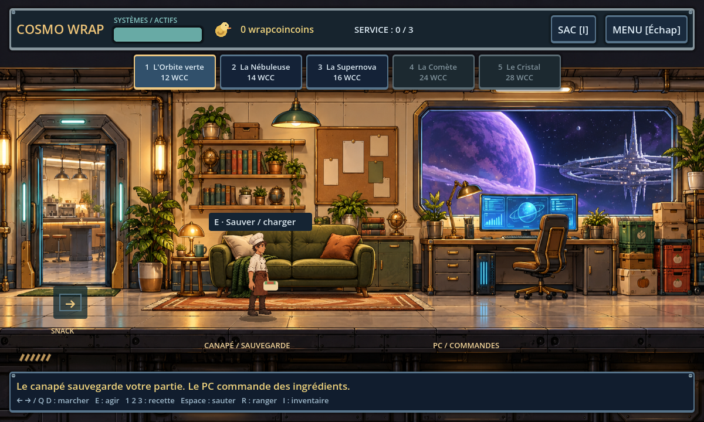
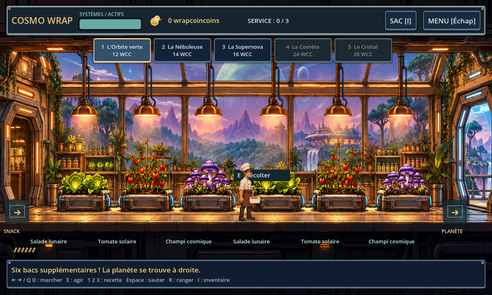
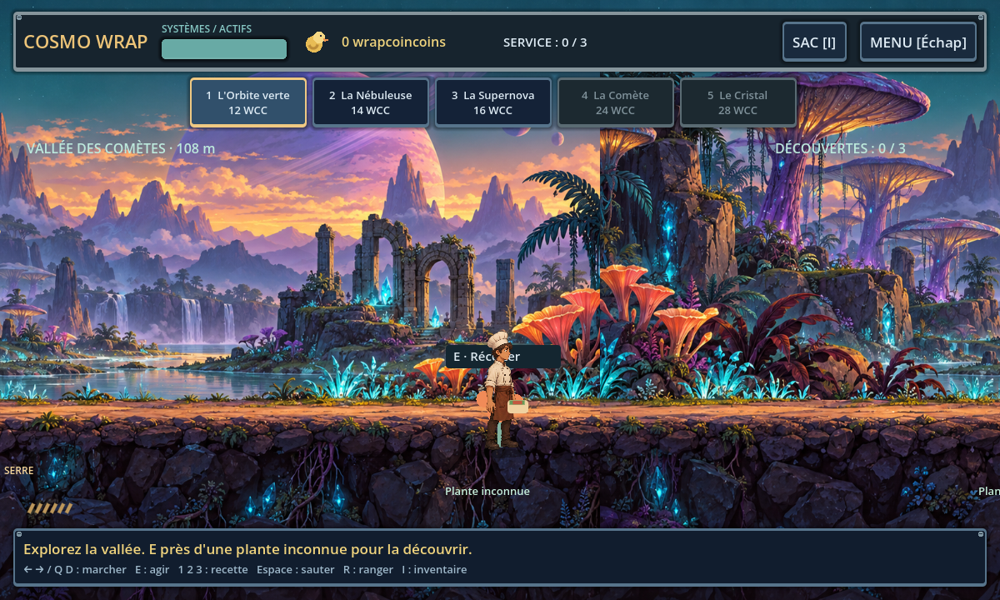
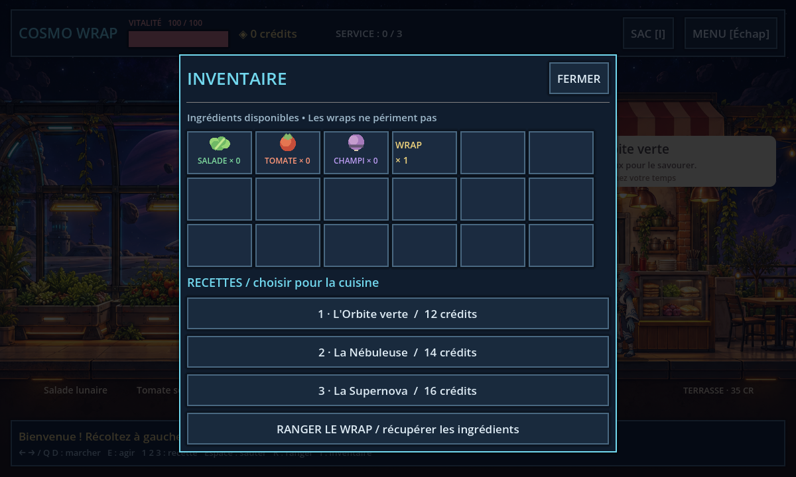
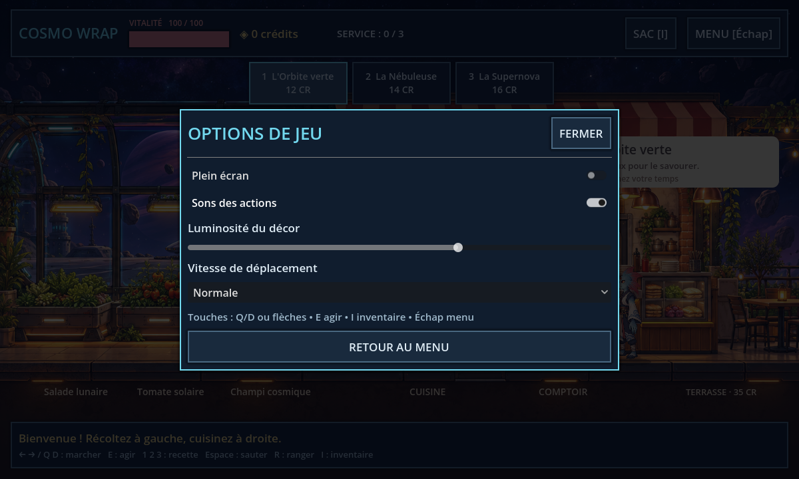
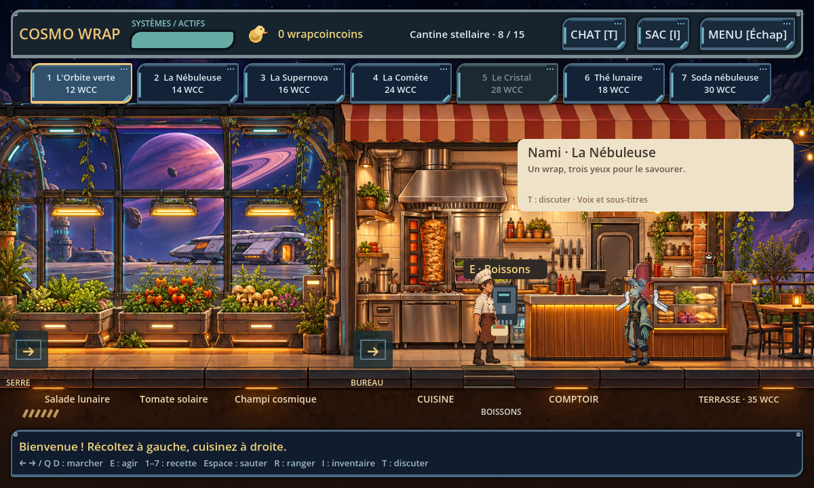

# Cosmo Wrap — Premier service

## Télécharger pour Windows

[Télécharger le jeu Windows 64 bits](https://github.com/keno681/essai/raw/refs/heads/master/downloads/CosmoWrap-Windows.zip)

Une fois le ZIP téléchargé, faire clic droit → **Extraire tout**, puis ouvrir
**CosmoWrap.exe** dans le dossier extrait. Garder `CosmoWrap.pck` à côté de
l'exécutable. Aucun moteur à installer séparément.

[Téléchargement léger de secours](https://github.com/keno681/essai/raw/refs/heads/master/downloads/CosmoWrap-Windows-Leger.zip)
contient `JOUER.cmd`, qui télécharge le moteur officiel au premier lancement
et vérifie son SHA-512 avant de le lancer. Cette alternative nécessite Internet.

L'archive Windows est contrôlée, mais le lancement sous Windows reste à tester.

Prototype original de jeu solo en 2D de côté, de gestion et d'humour.

## Mise à jour graphique

### Exploration, bureau et wrapcoincoins

L'interface utilise une console industrielle à bordures métalliques et accents
dorés, inspirée des interfaces de stratégie spatiale de StarCraft. La monnaie
est le **wrapcoincoin**, représenté par un petit canard dans le HUD.

Le snack garde ses trois plantes. La porte **SERRE** à gauche mène à six bacs
supplémentaires. À droite de la serre, la porte **PLANÈTE** ouvre une vallée
de 360 mètres à explorer. Récolter ses plantes avec E découvre le citron
astral, le piment comète et le riz de cristal. Ces découvertes débloquent
deux recettes, accessibles avec les touches 4 et 5, et les commandes au PC.

La porte **BUREAU** du snack, entre le jardin et la cuisine, mène à une pièce
séparée. Près du canapé, appuyer sur E pour **sauvegarder** ou **charger**.
La sauvegarde du canapé conserve l'inventaire, les découvertes, les livraisons,
les wrapcoincoins, le personnage et la progression. Elle reste distincte de
la reprise automatique à la fermeture du jeu. Près du PC, E ouvre le catalogue :
commander un lot de trois ingrédients coûte des wrapcoincoins et déclenche
une livraison après quatre secondes de jeu, une fois le PC fermé.

Les clients ont des répliques à l'arrivée et après leur commande, affichées
progressivement. Sous Windows, Godot utilise la synthèse vocale installée :
voix française si disponible, sinon une autre voix du système. Sans voix
installée, les sous-titres restent disponibles. **Options → Voix des clients**
active ou désactive les voix. Leur sortie audio Windows reste à confirmer ;
les dialogues et sous-titres ont été vérifiés sous Linux.







### HUD, inventaire et races

Interface de console spatiale : barre de raccourcis,
menu cliquable avec reprise, inventaire, personnage, options, nouveau service
avec confirmation et quitter. `I` ouvre l'inventaire avec quantités, icônes et
sélection des recettes ; `Échap` ouvre le menu. Les infobulles des recettes
montrent leurs ingrédients. Le menu et l'inventaire mettent la partie en pause.

Les options règlent le plein écran, les sons d'action, la luminosité du décor
et trois vitesses de déplacement. Elles sont conservées entre les lancements.

Sept races redessinées en HD sont proposées : Humain, Avien, Apex, Floran,
Hylotl, Glitch et Novakid. Choisir sa race dans **Menu → Personnage et races**.
Il s'agit d'illustrations générées pour ce fan-prototype et non des sprites
officiels extraits de Starbound. Les clients utilisent aussi ces races.
Ils entrent depuis la droite, marchent jusqu'au comptoir, attendent, puis
repartent avec leur wrap. Le client suivant arrive après leur sortie.





[Vidéo de l'arrivée et du départ des clients](art/clients-demo.mp4)

Décor original illustré de snack orbital : broche à kebab, cuisine inox,
comptoir éclairé, serre et terrasse. Le cuisinier et les clients sont dessinés
en 2D avec membres articulés, marche, respiration et gestes d'interaction.
Le cuisinier tient réellement son wrap à la main. Le décor a été généré pour
ce projet ; aucun visuel de Wrap House Simulator ou Fallout Shelter n'est inclus.


Vous récoltez au jardin orbital et sur la planète, préparez cinq recettes de wraps et servez
des clients extraterrestres patients. Trois commandes réussies terminent le
premier service ; vous pouvez continuer et ouvrir une terrasse pour 35 wrapcoincoins.
La terrasse augmente chaque vente de 5 wrapcoincoins. La reprise automatique
et la sauvegarde du canapé conservent maintenant aussi l'inventaire.

## Jouer

Ouvrir `project.godot` avec Godot 4.6.3 puis appuyer sur F6 ou F5, ou lancer :

```sh
godot --path .
```

Entrée commence la partie. Flèches ou Q/D (A/D aussi) déplacent le personnage ;
E récolte, cuisine, sert, passe une porte ou utilise le canapé/PC selon votre position.
Les touches 1 à 5 choisissent
la recette. Espace saute, R range un wrap en restituant ses ingrédients,
I ouvre l'inventaire, Échap ouvre le menu et N demande confirmation avant
de recommencer la progression.

Le jardin est à gauche ; la cuisine, le comptoir et la terrasse sont à droite.
Les plantes repoussent en 8 à 12 secondes. Les clients ne s'impatientent jamais.

## Validation

```sh
python3 tests/preflight.py
godot --headless --path . --script tests/game_test.gd
godot --headless --path . --quit-after 120
```

Utiliser un `XDG_DATA_HOME` temporaire pour les tests sous Linux : les tests
écrivent une sauvegarde de restaurant. Les données de conception se trouvent
dans `data/design.json`. Vérifier leurs cellules et références avant chaque build.

## Périmètre et crédits

Le prototype utilise un décor généré, des dessins vectoriels et du code créés pour ce projet.
Il n'inclut aucun fichier extrait de Starbound ou de Wrap House.
Les races de Starbound sont représentées par des illustrations redessinées.
Il ne nécessite aucun de ces jeux et n'est donc pas destiné à Melty.
Il n'a pas encore de voyage entre plusieurs planètes, de campagne, de musique ou de multijoueur.
Le moteur est Godot (https://godotengine.org), sous licence MIT.
La licence de diffusion et les autorisations de remix du projet restent à choisir
pour accorder des droits de réutilisation. Le dépôt et les archives sont fournis
pour permettre le téléchargement du prototype ; aucune publication Melty
n'a été effectuée.

## Clients variés (v5)

Chaque visite tire une race et une commande parmi les recettes débloquées, sans répéter immédiatement la race précédente. Taille (90 à 113 %), proportions de tête, couleurs, vêtements, pantalon, chaussures, lunettes et chapeaux sont aléatoires. Fez, fedora, casquette, casque, bonnet ou tête nue ; tentacules facultatifs ondulants, bouclés ou en zigzag. Les accessoires accompagnent les animations et les apparences du client actuel et du prochain client sont sauvegardées. Les dessins de base restent ceux des sept races redessinées.

## Restaurant spatial (v6)

Accessoires avec textures ombrées de tissu, métal et verre, et boutons de HUD à contours lumineux. Une Poké Ball décorative est cachée dans le restaurant sans collision ni interaction.

La réputation progresse aux seuils 3, 8 et 15 clients servis, avec des bonus permanents de vente de 1, 3 puis 5 WCC. Le menu « Évolution du restaurant » affiche les étapes. Le thé lunaire (touche 6) se débloque à 3 clients ; le soda nébuleuse (7) à 8 clients après découverte de ses ingrédients. Sélectionner une boisson puis appuyer sur E devant la machine, à droite de la cuisine ; servir au comptoir comme les wraps.

T ou le bouton CHAT ouvre une conversation avec le client présent. Bonjour, commande, planète et merci reçoivent des réponses prédéfinies ; les autres messages reçoivent une réponse générique. Ce chat local fonctionne sans serveur ni IA en ligne. Son historique et la progression sont sauvegardés.

## Chat autonome gratuit (v8)

T ou le bouton CHAT permet de discuter avec le client qui attend. Tout fonctionne immédiatement hors ligne, sans compte, clé API, abonnement, serveur ou modèle à télécharger. L’ancienne intégration OpenAI a été supprimée.

Le moteur local reconnaît les salutations, présentations, commandes, prix, ingrédients, boissons, origines, loisirs, goûts, races, blagues, humeur, progression, aide et au revoir. Il compose des réponses avec la commande réelle, les prix et la personnalité de chaque race, varie ses formulations, retient le nom du joueur et répond aux relances comme « pourquoi ? ». La mémoire du client actuel est sauvegardée et chargée ; elle s’efface au départ du client. Le journal de conversation reste consultable.

Il s’agit d’un moteur de dialogues contextuels à règles et modèles de phrases, pas d’un grand modèle de langage comme ChatGPT : les questions hors de ses sujets reçoivent une demande de clarification. Le chat n’envoie aucune donnée sur Internet et ne modifie pas les commandes ou ressources.

Validation : `godot --headless --audio-driver Dummy --path . --script tests/offline_chat_test.gd`, avec un `XDG_DATA_HOME` temporaire, teste les personnalités, variantes, mots accentués, relances, mémoire et sauvegardes.
