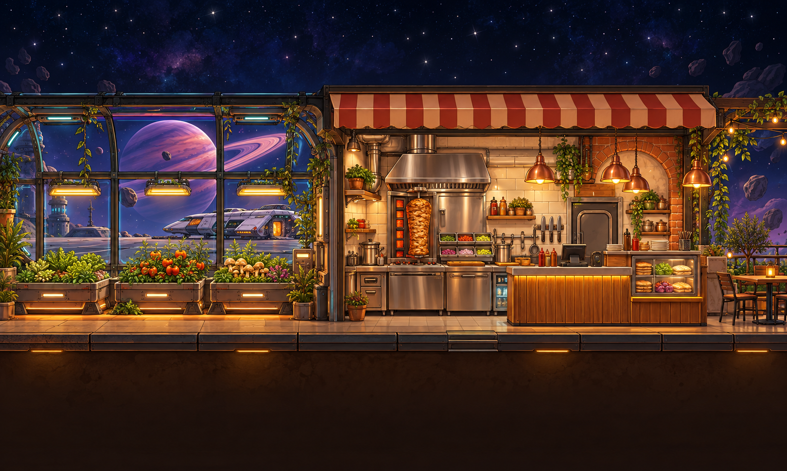
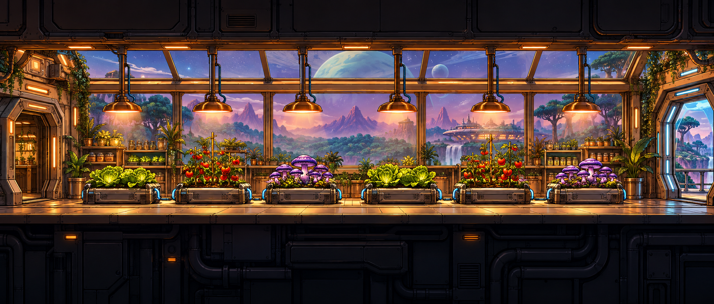
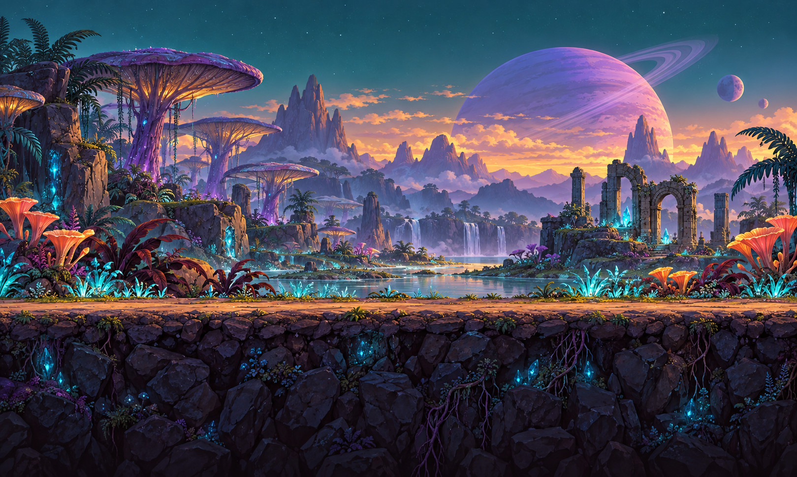

# COSMO WRAP BALL

### Un petit restaurant. Une grande galaxie. Des clients affamés.

Prépare tes wraps, invente tes boissons et fais grandir ton restaurant spatial. 
Seul ou avec un ami, sers des extraterrestres qui ont du caractère.

**GESTION 2D** · **SOLO & COOP À 2** · **WINDOWS** · **SANS CLÉ API**

[**⬇ Télécharger le jeu pour Windows**](https://github.com/keno681/essai/raw/refs/heads/master/downloads/CosmoWrapBall-Sources.zip) &nbsp; · &nbsp; [**📖 Guide du jeu**](GUIDE.md) &nbsp; · &nbsp; [**🛠 Signaler un problème**](https://github.com/keno681/essai/issues)

*Bienvenue dans ta cantine au milieu des étoiles.*

---

## À la carte

| 🌯 Cuisiner | 🥤 Préparer des boissons | 👽 Accueillir les clients |
| :--- | :--- | :--- |
| Glisse les ingrédients dans ta galette, compose une recette et sers ta commande. | Eau minérale, thé lunaire, baies nébuleuses et citron astral : chaque boisson a ses ingrédients. | Des apparences aléatoires, des conversations et une file d’attente qui avance au rythme du service. |
| **🌱 Cultiver** | **🪐 Explorer** | **🦆 Développer le restaurant** |
| Achète tes graines au PC : une graine donne 3 ingrédients, puis le bac devient vide. | Pars sur la planète pour trouver de nouveaux ingrédients et débloquer des recettes. | Gagne des wrapcoincoins, commande tes graines au PC et sauvegarde depuis le canapé. |

Une mauvaise commande peut être remise au client : wrap ou boisson incorrect, il part furieux sans payer. La commande est consommée, et le client suivant arrive après son départ.

## Un univers à découvrir

Les décors mêlent bois, métal, lumière chaude et vues sur l’espace. Ces images présentent les décors du jeu ; l’interface et les personnages s’ajoutent pendant la partie.

| La serre | La planète |
| :---: | :---: |
|  |  |

## Prêt pour ton premier service ?

1. [**Télécharge le ZIP Windows**](https://github.com/keno681/essai/raw/refs/heads/master/downloads/CosmoWrapBall-Sources.zip).
2. Fais clic droit sur le ZIP → **Extraire tout**.
3. Ouvre **JOUER.cmd** dans le dossier extrait.

Au premier lancement, le lanceur télécharge **Godot 4.6.3** depuis sa publication officielle et vérifie ses empreintes. Internet est nécessaire pour cette installation. Ensuite, tu peux jouer en solo hors ligne, sans compte ni clé API.

Le ZIP contient les sources et les ressources, sans moteur exécutable embarqué. Les dossiers **game** et **launcher** doivent rester à côté de **JOUER.cmd**. [Installation et informations de sécurité →](GUIDE.md#pack-windows--installation-automatique-du-moteur)

## Deux chefs, un même restaurant

Dans le menu, ouvre **COOP EN LIGNE · 2 JOUEURS** : l’un héberge, l’autre rejoint avec son adresse IP et le mot de passe du salon.

Vous partagez les stocks, les clients, les plantations, les découvertes et les wrapcoincoins. Chacun contrôle son personnage et peut cuisiner, servir ou explorer. Vous pouvez même vous passer une commande lorsque vous êtes proches.

**À la maison :** utilise l’IP locale du PC hôte. **Depuis deux logements :** la connexion directe utilise le port **UDP 16383** et demande une configuration réseau adaptée. [Configurer la coop →](GUIDE.md#coop-privée-à-deux)

## La Pokéball, pour faire évoluer ton jeu

Clique sur la Pokéball, colle un bloc de modification fourni dans notre conversation, puis choisis **Envoyer et relancer le jeu**.

En coop, les blocs envoyés par l’hôte peuvent être appliqués sur les deux PC, puis les jeux se relancent et se reconnectent. Le système vérifie les modifications et conserve des copies de sécurité. Il applique les blocs de code ; il ne comprend pas directement les demandes en français.

| Mise à jour pour les anciennes installations | Bloc à copier |
| :--- | :--- |
| Installer la synchronisation, hors coop, sur **les deux PC** | [Synchronisation Coop](https://raw.githubusercontent.com/keno681/essai/master/downloads/Synchronisation-Coop-Pokeball.json) |
| Séparer les ingrédients des wraps et des boissons, après installation de la synchronisation | [Ingrédients Boissons](https://raw.githubusercontent.com/keno681/essai/master/downloads/Ingredients-Boissons-Pokeball.json) |
| Planter avec des graines, récolter 3 ingrédients et acheter uniquement des semences au PC | [Système de graines](https://raw.githubusercontent.com/keno681/essai/master/downloads/Graines-Pokeball.json) |

**Le ZIP actuel inclut déjà ces mises à jour.** La synchronisation porte sur les fichiers texte et SVG ; les PNG et les sons nécessitent un transfert séparé. [Fonctionnement et limites →](GUIDE.md#console-pokéball)

<strong>🎮 Les commandes en un coup d’œil</strong>

| Commande | Action |
| :--- | :--- |
| **Q / D** ou **← / →** | Marcher |
| **Espace** | Sauter |
| **E** | Interagir |
| **I** | Inventaire |
| **T** | Discuter avec les clients |
| **Échap** | Menu |
| **Souris** | Choisir une porte, un bac ou une station ; glisser les ingrédients |

Les objets se mettent en surbrillance au survol et affichent leur nom.

<strong>🛠 Sources, développement et vérifications</strong>

Le dépôt contient les scripts Godot, les décors, les ressources et les tests. Pour travailler sur le jeu, ouvre **project.godot** avec **Godot 4.6.3**, en rendu **Compatibility**. Le lanceur du pack Windows permet la relance automatique par la Pokéball.

Les tests de gameplay et de coop ont été exécutés sous Linux, y compris la transmission des modifications, la relance et le retour arrière après échec. La relance coordonnée reste à essayer sur deux PC Windows.

[Instructions de développement →](GUIDE.md#développement-et-vérification) · [Empreinte du ZIP →](downloads/CosmoWrapBall-Sources.sha256) · [Vérification du moteur →](SECURITE.md)

---

**COSMO WRAP BALL** 
*Des wraps, des étoiles et quelques clients difficiles.*

[Le jeu](https://github.com/keno681/essai/raw/refs/heads/master/downloads/CosmoWrapBall-Sources.zip) · [Le guide](GUIDE.md) · [Les sources](https://github.com/keno681/essai)

